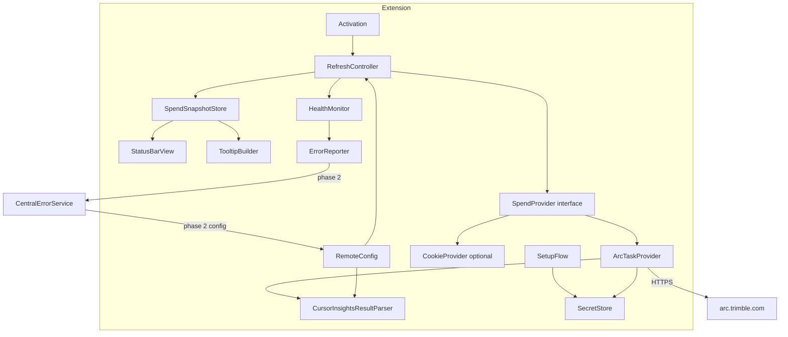

# PRD: Cursor Spend Status Bar (Trimble)

| Field | Value |
|---|---|
| Status | Draft |
| Last updated | 2026-09-25 |
| Owner | TBD |
| Current code | Fork of [drash-course/cursor-spending-extension](https://github.com/drash-course/cursor-spending-extension), now v1.1.0 POC, heavily modified |
| Intent | Specification for a from-scratch rewrite; the current fork is the prototype |

## 1. Background

The extension started as a fork of a small open-source status-bar extension that scraped Cursor's dashboard with a pasted session cookie and showed "Auto %" and "API %". Trimble changes since then:

- Enterprise plans do not return `planUsage`; added `usage-summary` and aggregated-usage-events fallbacks.
- Values switched from percentages to dollars (cents converted to USD).
- Status bar cycles between cycle spend vs budget and today's spend.
- Credentials moved to SecretStorage; security review fixes (request timeouts, escaped tooltip content, URL allow-list, webview CSP with nonce, legacy-setting migration).
- Cursor Admin API key path added, then rejected for rollout (`admin:*` scope is too broad to hand to thousands of users).
- Corporate direction is now **Arc** via the Cursor Insights skill, using each user's own Arc User API key. v1.1.0 POC implements this with a cookie fallback and source colours.

The code carries layers of abandoned approaches and upstream naming (publisher `drash-course`, "Auto/API" labels). A clean rewrite is warranted.

## 2. Problem

Developers cannot see their own Cursor spend without opening the web dashboard. Budget overruns are noticed late. Trimble needs an at-a-glance, per-user spend indicator that uses sanctioned authentication and does not distribute admin credentials or rely on cookie scraping.

## 3. Goals

1. Show the signed-in user's **billing-cycle spend vs limit** and **today's spend** in the Cursor status bar.
2. Warn the user at **85% of budget** and give them a direct link to request a limit increase.
3. Authenticate through **Arc** with the user's **own Arc User API key** (Arc Embedded pattern P3).
4. Never ship, store, or request shared or admin credentials.
5. Setup takes under 2 minutes for a typical developer.
6. Keep load on Arc and the shared Cursor Admin API low enough for rollout to thousands of users.
7. Ship with its own automated test suite.
8. Phase 2: report errors centrally so failures can be detected and corrected remotely (self-healing).

## 4. Non-goals

- Team-wide, manager, or leaderboard views (that is Cursor Insights in Arc chat).
- Usage analytics beyond spend (models, lines, requests).
- Invoice reconciliation (figures are Dashboard Cost, not invoice amounts).
- Supporting VS Code outside Cursor as a first-class target.
- Application keys, on-behalf-of headers, or a Trimble-hosted gateway (revisit only if Arc ships a structured self-spend endpoint that requires it).
- Raising limits automatically; the extension only links to the request process.

## 5. Users

| Persona | Need |
|---|---|
| Developer | Glance at spend and today's burn while coding; get warned before hitting the limit and know how to ask for more |
| Team lead | Encourage team to self-monitor without granting admin data access |
| Platform / AI enablement | Sanctioned auth, auditable, low support burden, low API load, visibility of failures across the fleet |

## 6. Authentication model

| Mode | Role | Notes |
|---|---|---|
| Arc User API key | **Primary** | User mints key at arc.trimble.com → Settings → API Keys (type User). Key is the identity. Stored in SecretStorage. Max lifetime 365 days. |
| Cursor session cookie | Fallback, personal/dev | `WorkosCursorSessionToken`; brittle, undocumented endpoints. Candidate for removal once Arc path is proven. |
| Cursor Admin API key | **Removed** | Requires `admin:*`; exposes all users' data. |
| Arc Application key | **Rejected** | Cannot be safely distributed; Arc trusts any OBO header. |

References: [Hub vs. Embedded Mode](https://app.notion.com/p/fd9e7591ef9249b98ba7a49ed0be491e), [Arc Core & Arc Skills API](https://app.notion.com/p/330c1b3dd2568027be97f445dcc10211), [Cursor Insights skill](https://app.notion.com/p/383c1b3dd25681818982f563cc5607b2), [platform requirements](https://app.notion.com/p/802a5c6999614aed8cc2f3b7907f1231).

## 7. Functional requirements

### 7.1 Setup

- FR-1: Command **Cursor Spending: Set Up** opens a guided flow: link to Arc Settings, paste Arc key, enter full Cursor email (pre-filled if discoverable).
- FR-2: Setup validates the key (`GET /api/v1/skills/`) and that Cursor Insights is available and credential-ready (`GET /skills/{id}/tokens`). Clear message if not.
- FR-3: Command **Cursor Spending: Sign Out** clears all stored secrets.
- FR-4: Key is stored only in SecretStorage; never in settings, logs, or telemetry.

### 7.2 Data retrieval

- FR-5: Fetch via `POST /api/v1/tasks/` with explicit skill selection (Cursor Insights only), streaming, low `max_turns`, bounded timeout.
- FR-6: Month-to-date and today's spend from `get_filtered_usage_events` with `email`, summing raw `chargedCents` / 100 (per Cursor Insights cost rules). Limit from `get_team_spend` filtered to the user's email. Never use `get_daily_usage` / `get_user_usage` for dollars.
- FR-7: Parse structured values from SSE `tool.result` events, not the LLM's final prose. Reject results whose email does not match the configured email.
- FR-8: Discover the Cursor Insights skill ID automatically; allow a setting override.
- FR-9: Replace the task-based fetch with a structured Arc endpoint when one exists, behind the same internal interface.
- FR-9a: Fetch the limit at most once per day (it rarely changes); hourly refreshes fetch spend only, to cut Cursor Admin API calls.

### 7.3 Status bar

- FR-10: Cycles through views every N seconds (configurable):
  1. Spend vs limit: `$spent / $limit`
  2. Today: `$today today`
  3. Budget warning (only when spend is at or above the warning threshold): see FR-11a.
- FR-11: Source indication. In release builds the spend and today views use **default status-bar colours**; the data source appears only in the tooltip (e.g. "Source: Arc · Cursor Insights skill"). Colour is reserved for the budget warning (FR-11a) and errors.

  The POC colours the item by source as a **visual debugging aid only**. This must not ship; if kept, it sits behind an off-by-default developer setting:

  | Source (POC debug) | Colour | Implementation |
  |---|---|---|
  | Arc (Cursor Insights) | **Green text** | Contributed theme colour `cursorSpending.arcForeground` set as the item's foreground. VS Code does not allow extensions to set a green status-bar background (only `statusBarItem.errorBackground` and `statusBarItem.warningBackground` are supported). |
  | Fallback: local Cursor sign-in | **Yellow background** | `statusBarItem.warningBackground`. Cookie built from Cursor's stored sign-in token. Tooltip explains why Arc was not used. |
  | Fallback: pasted cookie | **Red background** | `statusBarItem.errorBackground`. Used only when the Cursor sign-in is unavailable or rejected. |
  | Not configured / error | Default colours | Error icon and actionable tooltip. |

- FR-11a: Budget warning view when spend reaches **85%** of the limit (configurable):
  - Text: `$(warning) 87% of budget — request increase` (at 100%+: `$(warning) Budget reached — request increase`).
  - Background: `statusBarItem.warningBackground` (yellow) for that view only. This is the only coloured state in normal operation.
  - Clicking the status bar while the warning view is showing opens the **increase-limit link** (FR-11b). Clicking during other views keeps the default action.
  - Tooltip also shows the warning line and the link whenever the threshold is reached.
  - No warning view when the limit is unknown.
- FR-11b: Increase-limit link comes from a setting with an org-provided default (the Trimble request process URL, to be supplied). Link must pass the external-URL allow-list.
- FR-12: Shows last-good values with a "stale" indicator when a refresh fails.
- FR-13: Distinct states: not configured, loading, OK, stale, error (with action).

### 7.4 Tooltip

- FR-14: Data source; cycle spend, limit, remaining, percent with progress bar; today's spend; average daily spend for the cycle; cycle end date if known; last updated time.
- FR-15: Actions: Refresh now, Open Cursor dashboard, Open Arc settings, Request limit increase (when at or above threshold).
- FR-16: Note that figures are Dashboard Cost and may differ slightly from invoices.

### 7.5 Refresh

- FR-17: Default refresh **every 60 minutes**; minimum 60 minutes for the Arc path. Each refresh is an Arc LLM task billed to the user's company and fans out to the shared Cursor Admin API.
- FR-17a: Randomised start offset (jitter of up to the full interval) so thousands of editors do not refresh at the same minute (for example after a company-wide restart at 9:00).
- FR-17b: Persist the last snapshot and its timestamp; on startup, show it immediately and only fetch if it is older than the interval.
- FR-18: Manual refresh command, debounced (at most one per 5 minutes) so repeated clicks do not fire parallel tasks.
- FR-19: Pause refresh when the window has been unfocused for a long period; refresh on regain if stale.
- FR-19a: Only one editor window per machine refreshes; other windows reuse the shared snapshot (globalState).

### 7.6 Errors and local self-healing (phase 1)

- FR-20: 401 from Arc → "Arc key invalid, expired, or revoked" with a link to create a new one.
- FR-21: Task failed due to skill credentials → "Cursor Insights is not ready; contact Arc Craft".
- FR-22: Rate-limit text from Cursor Insights → exponential backoff (up to 4 hours) and keep last-good values.
- FR-23: All errors logged to an Output channel without secrets.
- FR-24: Local recovery steps before surfacing an error: clear cached skill ID and rediscover; retry once with backoff; then fall back to cookie if configured.
- FR-25: Circuit breaker: after 3 consecutive Arc failures, stop Arc calls for 1 hour and show stale data with the failure reason.

### 7.7 Central error reporting and remote self-healing (phase 2)

- FR-26: Report errors to a central service (tool TBD, see open questions). Each report includes: extension version, editor version, OS, error code (from a fixed taxonomy), HTTP status, Arc task status, parser outcome (for example "expected pattern not found"), timing, and a hashed user identifier. Never the Arc key, cookie, email, or raw tool output.
- FR-27: Users are informed on first run; reporting respects the editor's telemetry setting (`telemetry.telemetryLevel`) and has its own opt-out.
- FR-28: Remote configuration fetched daily from the central service and cached, used for self-healing without shipping a new version:
  - Parser patterns (in case Cursor Insights output wording changes)
  - Refresh interval and jitter (to shed load)
  - Cursor Insights skill ID
  - Increase-limit URL and warning threshold
  - Kill switch / "Arc path disabled, use fallback" flag with a user-facing message
  - Minimum supported extension version (prompt to update)
- FR-29: Remote config is signed or served from an allow-listed HTTPS host; invalid config is ignored and the bundled defaults are used.
- FR-30: Central dashboard/alerts for error rate by code and version so the team sees breakage (for example parser failures after a skill update) before users report it.

## 8. Non-functional requirements

- NFR-1 Security: no shared credentials; HTTPS only to an allow-listed host set (`arc.trimble.com`, the phase 2 reporting/config host, and `cursor.com` while cookie fallback exists); tooltip content escaped; webviews use strict CSP with nonce.
- NFR-2 Privacy: only the user's own spend is requested or displayed. Phase 1: no telemetry. Phase 2: error reports only, no spend values or PII (FR-26, FR-27).
- NFR-3 Performance: activation under 100 ms of work before first async fetch; no blocking of editor startup.
- NFR-4 Reliability: request timeouts on every call; single in-flight refresh.
- NFR-5 Load (must be confirmed with Arc Core and Arc Craft before GA):

  | Users | Arc tasks per minute (hourly refresh) | Cursor Admin API calls per minute |
  |---|---|---|
  | 1,000 | ~17 | ~33 (2 usage calls per task) |
  | 2,000 | ~33 | ~67 |
  | 5,000 | ~83 | ~167 |

  The Cursor Admin API allows about **20 requests per minute** for the team key held by Cursor Insights, shared with every other Cursor Insights user. Even hourly refresh exceeds this above roughly 600 users. **GA is blocked** until Arc Craft provides server-side caching or a structured, cached self-spend endpoint; FR-9a, FR-17a, FR-19a reduce but do not remove the gap.
- NFR-6 Compatibility: Cursor on Windows first; macOS and Linux should work without code changes.
- NFR-7 Maintainability: TypeScript strict mode; modules separated by concern (see section 10); test suite per section 9.

## 9. Test suite

The extension must ship with its own automated tests, run locally (`npm test`) and in CI on every pull request. A failing test blocks merge.

| Layer | Tooling | Scope |
|---|---|---|
| Unit | Mocha or Vitest, no editor required | Cursor Insights result parser (against captured `tool.result` fixtures), SSE stream parser, money/formatting, threshold and warning logic, view-cycle state machine, backoff and circuit breaker, config validation |
| Contract | Recorded fixtures | Captured real Arc SSE streams (success, `task.failed`, 401, rate-limit text, unexpected wording). Re-record when Cursor Insights changes; a parser change must come with a fixture. |
| Integration | `@vscode/test-electron` | Activation, commands registered, status bar states, source shown in the tooltip, warning view and click-through link, SecretStorage handling, setup webview messages, with a mocked `SpendProvider` |
| Live smoke (manual / nightly, optional) | Gated by env var with a test Arc key from a vault | One real task end-to-end; never runs in PR CI |

- Coverage target: 80% lines for parser, providers, and state logic.
- HTTP mocked at the transport layer (for example `nock`); no real network in unit or integration tests.

## 10. Settings and commands (target)

| Setting | Default | Purpose |
|---|---|---|
| `cursorSpend.email` | `""` | Full Cursor account email |
| `cursorSpend.refreshMinutes` | 60 | Refresh interval (min 60 for Arc) |
| `cursorSpend.cycleSeconds` | 5 | Status bar alternation |
| `cursorSpend.warnPercent` | 85 | Budget warning threshold |
| `cursorSpend.increaseLimitUrl` | Org default (TBD) | Link opened from the warning view |
| `cursorSpend.arcBaseUrl` | `https://arc.trimble.com/api/v1` | Arc environment |
| `cursorSpend.arcSkillId` | `""` | Override auto-discovered Cursor Insights ID |
| `cursorSpend.enableCookieFallback` | false | Opt-in legacy path |
| `cursorSpend.errorReporting` | true (phase 2) | Opt-out of central error reports |

| Command | Purpose |
|---|---|
| Cursor Spending: Set Up | Guided Arc key + email setup |
| Cursor Spending: Refresh | Manual refresh (debounced) |
| Cursor Spending: Request Limit Increase | Open the increase-limit link |
| Cursor Spending: Sign Out | Clear secrets |
| Cursor Spending: Show Log | Open Output channel |

No theme colours are contributed in release (the POC's `cursorSpending.arcForeground` is debug-only).

## 11. Target architecture (rewrite)

- `SpendSnapshot`: `{ spendUsd, limitUsd, todayUsd, percentUsed, cycleEnd?, fetchedAt, source }` — the only shape the UI consumes. Dollars as numbers; no cents/percent ambiguity.
- `SpendProvider`: `fetch(): Promise<SpendSnapshot>`; Arc task provider now, structured Arc endpoint later, cookie optional.
- `StatusBarView`: owns the view cycle (spend, today, warning) and warning colour; pure state logic unit-tested separately from the VS Code API.
- `HealthMonitor`: backoff, circuit breaker, local recovery (FR-24, FR-25); emits error events.
- `ErrorReporter` and `RemoteConfig`: no-ops in phase 1, implemented in phase 2.
- Parser isolated and driven by patterns that can be overridden by remote config.
- New publisher/ID under Trimble; fresh `package.json`; no upstream naming.

## 12. Rollout

| Phase | Scope | Exit criteria |
|---|---|---|
| POC (done: v1.1.0) | Current fork + Arc provider + source colours, author only | Correct numbers vs dashboard for one user |
| Phase 1: Pilot | Rewrite with test suite, 85% warning, hourly refresh with jitter, local self-healing; 10–20 volunteers | Setup under 2 min; tests green in CI; no credential issues; Arc load acceptable |
| Phase 2: Scale | Central error reporting, remote config/self-healing; wider rollout | Error dashboard live; remote config proven (kill switch, parser update) |
| GA | Internal distribution (VSIX or private marketplace) | Arc Craft caching or structured endpoint (NFR-5); Arc Core / Arc Craft / AI Safety sign-off |

### POC findings (2026-09-25, v1.1.4)

- Arc User key and Arc Application key both authenticate, discover Cursor Insights (`skl_84c336946a`), and run the task; `X-Account-Id` was not required.
- Both fail with `credential_required`: `GET /skills/skl_84c336946a/tokens` returns `CURSOR_API_KEY` and `CURSOR_ORG_API_KEY` as `is_provided: false`. The skill's credentials are not available to callers outside the account(s) that stored them, regardless of key type.
- **Blocker:** Arc Craft must provide Cursor Insights credentials at platform/skill level (and ideally make `CURSOR_ORG_API_KEY` optional). Until then the extension runs on the cookie fallback.
- Each failed attempt is a billed Arc task taking ~40 s (the skill's `bulk_invoke_skill` waits ~30 s before failing).

## 13. Dependencies and approvals

- Arc Craft: Cursor Insights access policy (self-only for normal users), skill availability, credential readiness, **server-side caching or structured self-spend endpoint** (NFR-5).
- Arc Core: User-key skill restriction, acceptable polling rate, future structured endpoint.
- AI Safety & Enablement: per-user spend data is Tier 2; confirm acceptable exposure model; review phase 2 error-report payload.
- Owner of the limit-increase process: provide the URL for FR-11b.

## 14. Open questions

1. Can a normal user query other users' spend through Cursor Insights? If yes, Arc Craft needs self-scoping regardless of this extension.
2. Can User keys be restricted to one skill?
3. Is there a way to discover the user's Cursor email automatically (Arc profile, Cursor API) instead of asking?
4. Does Arc expose cycle end date / limit type (hard vs soft) through Cursor Insights?
5. Keep or drop the cookie fallback at GA?
6. Distribution channel for internal extensions?
7. What is the increase-limit request URL/process (ServiceNow, Jira, form)?
8. Which central tool receives phase 2 error reports and serves remote config (for example Azure Application Insights, Datadog, an Arc usage endpoint)? Who owns it?

## 15. Current prototype inventory (to be replaced)

- Single file `src/extension.ts` (~1,650 lines): Arc task client (skill discovery, SSE streaming, tool-result parsing), cookie client, usage-summary mapping, aggregated events for today, tooltip, two setup webviews (Arc key, session cookie), source colours.
- Commands: Refresh, Set up Arc API key, Configure session token, Show log.
- Settings: `refreshInterval` (default 20), `statusBarCycleSeconds`, `lookupEmail`, `arcBaseUrl`, `arcSkillId`.
- Gaps vs this PRD: no 85% warning view or increase-limit link, refresh default not yet 60 minutes, no jitter or shared snapshot, no tests, no error reporting.
- Known debt: upstream "Auto/API" labels and percent fields in `PlanUsage`; mixed cents/percent semantics; month-to-date assumes the cycle starts on the 1st.
